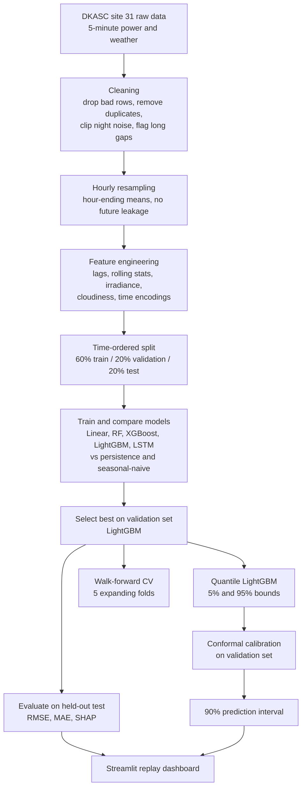

# AI-Powered Solar Power Forecasting (DKASC Site 31)

**Live dashboard:** https://solar-forecasting-djnx5eh5qcfswhwodaguxy.streamlit.app/
*(a replay of the held-out test period, not live plant telemetry; the app may take ~30 s to wake up)*

Forecasts a solar plant's power output **one hour ahead**, and says **how sure it is**, using only information available at the moment the forecast is issued.

---

## The problem
Solar output changes with every passing cloud. Grid operators, plant owners and energy traders need to know how much power will arrive in the next hours, because:

- Supply and demand on a grid must match at every moment. A surprise drop in solar output has to be covered by other generation, usually at short notice and higher cost.
- Plants that sell electricity ahead of time are exposed to penalties or lost revenue when real output differs from the plan.
- Batteries and flexible loads (for example EV charging or water pumping) can only be scheduled well if the next few hours are predictable.

The simplest forecast is **persistence**: "the next hour will look like this hour". It fails exactly when it matters, at sunrise, sunset and cloudy periods.

## What this project does
1. Predicts the plant's AC power **1 hour ahead**, well beyond the persistence baseline (about **61% lower RMSE** on held-out data).
2. Attaches a **calibrated 90% prediction interval**, so a user sees a range as well as a number: "expect about 2.1 kW, 90% likely between 1.6 and 2.6 kW".
3. Shows the result in an interactive **replay dashboard** comparing the model, the interval and persistence side by side.

## How it could be used
| User | Decision the forecast supports |
|---|---|
| Grid or microgrid operator | How much backup generation or storage to hold for the next hour; the interval width sets the size of the reserve |
| Plant owner / energy trader | Planning how much energy to offer for the coming hour, and how much risk the plan carries |
| Battery or load scheduler | Charging or running flexible loads when solar output is expected to be high |

The **interval is the useful part for decisions**: a narrow band means the operator can plan tightly, a wide band means keep a larger buffer.

---

## How it works


### Design choices worth knowing
- **No data leakage.** Hourly means use the hour *ending* at the timestamp; features use only past values; scalers are fit on training data only; a gap is kept between splits so targets never overlap.
- **Relative target.** Power is modelled as a fraction of a trailing capacity estimate, so slow panel degradation over the years does not create a train/test mismatch.
- **Model chosen on validation, not test.** The test set is touched once, for reporting.
- **Time-ordered validation.** Random splits would leak neighbouring hours; walk-forward CV only ever trains on the past.
- **Honest interval reporting.** Coverage is measured on **daytime hours only**, because at night output is exactly zero and would trivially inflate it.

---

## Results (held-out test, 2023-05 to 2025-09)
| Metric | Value |
|---|---|
| Best model (chosen on validation) | LightGBM |
| Test RMSE | 0.153 kW (about 4.9% of plant capacity) |
| Improvement over persistence | about 61% lower RMSE |
| R² | 0.98 (inflated by all-zero night hours; RMSE as % of capacity is the fairer measure) |
| Other tree models | XGBoost and Random Forest within 3% of LightGBM |

**Walk-forward cross-validation (5 expanding folds):** RMSE = `[MEAN ± STD]` kW, `[GAIN]`% better than persistence on average. *(fill in from the notebook output)*

**Prediction intervals (quantile LightGBM + conformal calibration):** the calibrated 90% band covered `[COVERAGE]`% of daytime test hours, with an average width of `[WIDTH]` kW. *(fill in from the notebook output)*

**Replay check:** the streaming replay scored 239 one-hour-ahead forecasts at 0.126 kW RMSE against 0.422 kW for persistence.

## Using the dashboard
- **Black line:** actual power. **Red dashed line:** the model's forecast. **Orange band:** 90% interval. **Grey dotted line:** persistence.
- **Tiles:** running RMSE of the model and of persistence, and how often the actual value stayed inside the band.
- **Controls:** play or pause the replay, change speed, and change the time window shown.
- Look at cloudy days: persistence lags behind sudden changes, while the model and its band adapt.

Run it locally:
```bash
pip install -r requirements.txt
python -m streamlit run app.py
```

## Repository contents
| File | Purpose |
|---|---|
| `Solar_Forecasting_DKASC.ipynb` | Full pipeline: loading, EDA, features, models, tuning, SHAP, intervals, walk-forward CV, replay |
| `app.py` | Streamlit replay dashboard |
| `dashboard_data.csv` | Test-period actuals, forecasts and intervals used by the dashboard |
| `requirements.txt` | Dashboard dependencies |

To re-run the notebook, download the DKASC site 31 data (`74-Site_DKA-M18_C-Phase-site31.csv`) from the [DKASC website](https://dkasolarcentre.com.au/) and place it next to the notebook. The notebook needs `numpy pandas matplotlib seaborn scikit-learn xgboost lightgbm tensorflow shap` and runs in about 10 minutes on one CPU.

---

## Limitations (stated up front)
- **Single site, single (desert) climate.** Results may not transfer to cloudier or higher-latitude locations.
- **The dashboard is a replay** of historical data, not a live feed. A live version would need real-time plant telemetry.
- **1-hour horizon only.** Day-ahead scheduling needs longer horizons and weather forecasts.
- **Hyperparameter tuning did not help:** tuned XGBoost was slightly worse than untuned.
- **The LSTM varies from run to run** and is not a strength of this project.
- Features come from recent plant and on-site weather measurements. Forecast weather (for example numerical weather predictions) is not used.

## Next steps
- Multi-horizon forecasts (3 h, 6 h, 24 h) with an error-versus-horizon curve.
- Test on a second site or climate to measure how well the model transfers.
- Add forecast weather as input and measure whether it beats the current features.
- Serve the model behind an API for real-time use.

## Tech
Python, pandas, scikit-learn, LightGBM, XGBoost, TensorFlow/Keras, SHAP, Streamlit, Plotly.
